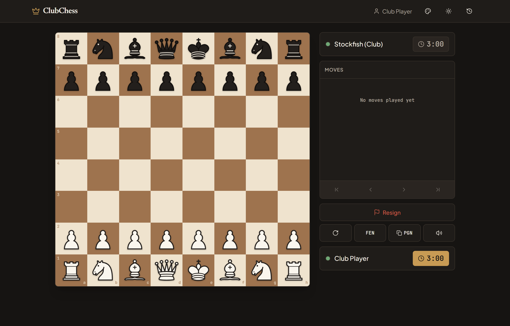
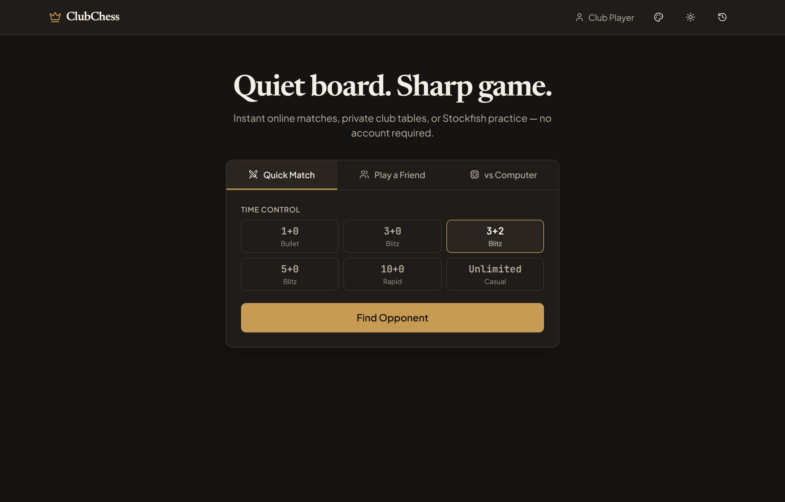

# ClubChess

**Quiet board. Sharp game.**

An editorial, realtime chess club built for instant play — online matchmaking, private shareable tables, and client-side Stockfish 19 WASM practice — deployed as a single **Cloudflare Worker** with **SQLite-backed Durable Objects** and **WebSocket Hibernation**.

No accounts. No logins. No clutter. Just open a table and play.

**Live Demo:** [clubchess.harisharraz02.workers.dev](https://clubchess.harisharraz02.workers.dev)



---

## Visual Tour

| Walnut Club Lobby (Dark) | Daylight Salon Arena (Light) |
| :---: | :---: |
|  |  |

---

## Features

- **Quick Match** — Instant per-time-control pairing (`1+0`, `3+0`, `3+2`, `5+0`, `10+0`, `Unlimited`) backed by hibernatable `MatchmakerDO` WebSockets.
- **Private Tables** — One-click room creation with shareable invite links (`/room/:code`), seat-token reconnection, spectator fallback, draw offers, abandonment claims, and side-swapping rematches.
- **Solo vs Stockfish 19 WASM** — Single-threaded Stockfish 19 lite running in a browser Web Worker (zero `SharedArrayBuffer` / COOP-COEP friction) with four strength tiers: **Novice (~800)**, **Club (~1300)**, **Candidate (~1800)**, and **Master (~2200)**.
- **Authoritative FIDE Rules & Clocks** — Server-validated moves via `chess.js`, server-authoritative increment clocks, timeout vs. insufficient-material adjudication, threefold repetition, 50-move rule, and unified Durable Object `alarm()` scheduling.
- **Editorial Design & Tactile Board** — Custom vector Staunton pieces, drag-and-drop + click-to-move, legal move dots/capture rings, check highlight, promotion picker, Web Audio sound cues, **Walnut Club** (dark) & **Daylight Salon** (light) themes, and 3 board finishes (**Walnut & Maple**, **Tournament Slate**, **Linen & Forest**).
- **Local Match History & Replay** — Automatically stores your last 50 completed games in `localStorage` with full move-by-move scrubbing (`/replay/:id`) plus one-click **PGN** and **FEN** export.

---

## Architecture

Everything ships in a **single Cloudflare Worker** (`@cloudflare/vite-plugin`):

```text
Browser (React 19 + Tailwind CSS v4 + Stockfish 19 WASM Worker)
   │
   ├── GET  /*              ──▶ Cloudflare Static Assets (SPA fallback)
   ├── POST /api/rooms      ──▶ Edge Worker ──▶ GameRoomDO (SQLite + Alarm)
   ├── WS   /ws/queue/:tc   ──▶ MatchmakerDO (WebSocket Hibernation Queue)
   └── WS   /ws/room/:id    ──▶ GameRoomDO   (Authoritative Rules, Clocks & Sync)
```

| Layer | Technology |
| :--- | :--- |
| **Edge & Realtime** | Cloudflare Workers, SQLite Durable Objects (`GameRoomDO`, `MatchmakerDO`), WebSocket Hibernation API |
| **Frontend** | React 19, TypeScript 5, Vite 8, Tailwind CSS v4, Lucide Icons |
| **Chess Engine & Rules** | `chess.js` (shared FIDE validation), Stockfish 19 Lite Single-Threaded WASM |
| **Testing** | Vitest 4 (unit tests) + `@cloudflare/vitest-pool-workers` (real `workerd` Durable Object integration tests) |

---

## Quick Start

### Prerequisites

- Node.js `>= 20`
- npm

### Run Locally

```bash
npm install
npm run dev
```

Open [http://localhost:5173](http://localhost:5173). Both the Vite frontend and the local Cloudflare Worker (`GameRoomDO` + `MatchmakerDO`) run together — open two browser tabs to test realtime multiplayer locally.

### Run Tests & Checks

```bash
npm run typecheck     # TypeScript strict check (tsc --noEmit)
npm test              # Unit tests (protocol, clocks, UCI parser, storage, sessions)
npm run test:worker   # Cloudflare Durable Object integration tests (workerd)
npm run build         # Production Worker + Client bundle
```

---

## Deploy to Cloudflare Workers

Deploy globally on Cloudflare's edge network in two commands:

```bash
npx wrangler login
npm run deploy
```

`wrangler.jsonc` is preconfigured with:
- `assets.not_found_handling: "single-page-application"`
- `assets.run_worker_first: ["/api/*", "/ws/*"]`
- SQLite Durable Object migrations (`new_sqlite_classes: ["GameRoomDO", "MatchmakerDO"]`)

---

## Project Structure

```text
chess-club/
├── public/engine/               # Single-threaded Stockfish 19 Lite JS + WASM
├── docs/screenshots/            # README visual snapshots
├── src/
│   ├── shared/                  # Protocol types, time controls, FIDE clock logic
│   ├── worker/                  # Edge router, GameRoomDO, MatchmakerDO
│   └── client/
│       ├── audio/               # Web Audio move/capture/check/end cues
│       ├── components/          # ChessBoard, StauntonPieces, Lobby, MatchArena, etc.
│       ├── engine/              # Stockfish Web Worker adapter & UCI parser
│       ├── session/             # Unified GameSession (LocalAISession & MultiplayerSession)
│       ├── storage/             # Guest prefs, seat tokens, 50-game local history
│       └── styles/              # Editorial semantic design tokens (tokens.css)
└── tests/
    ├── unit/                    # Vitest unit tests (28 tests)
    └── worker/                  # Cloudflare Worker DO tests (10 tests)
```

---

## License

MIT
